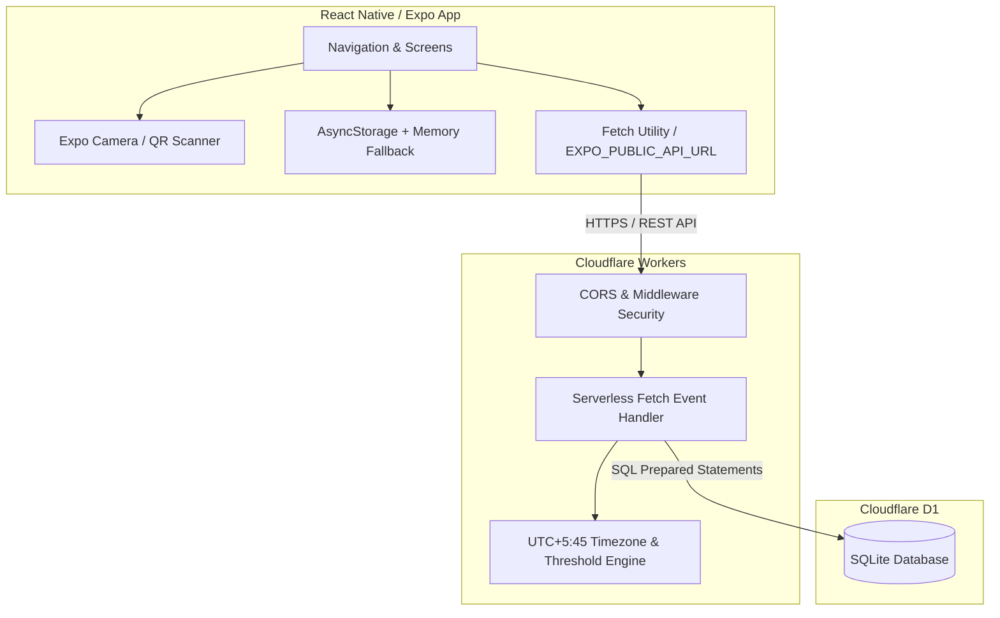
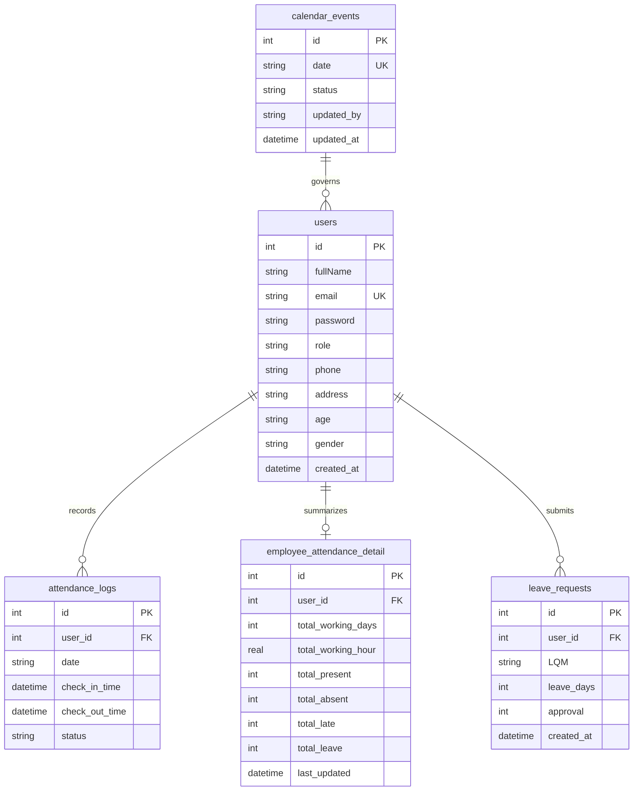

# 🏢 Advanced Employee Attendance Management System

[](https://github.com/HimmatRana721/Advance_attendance_Application)
[](https://expo.dev/)
[](https://workers.cloudflare.com/)
[](https://developers.cloudflare.com/d1/)
[](LICENSE)

An enterprise-grade, cross-platform **Employee Attendance Management & Time-Tracking System** engineered with a **React Native (Expo)** mobile application and a high-performance **Cloudflare Workers** serverless API backend running **Cloudflare D1 (SQLite at the Edge)**.

Designed for modern remote/hybrid workforces, this system eliminates manual register logging through dynamic/static **QR Code Scanning**, automated **Timezone Calculation (`UTC+5:45` Nepal Standard Time)**, real-time status evaluation, automated shift cleanup, and a multi-role administrative workspace.

---

## 📐 System Architecture

The application adopts a decoupled, serverless **Monorepo** pattern for ultra-low latency, zero cold starts, and seamless edge distribution.



---

## 🛠️ Tech Stack & Engineering Rationale

| Layer | Technology | Architectural Rationale |
| :--- | :--- | :--- |
| **Mobile Client** | React Native (v0.81), Expo (v54), React Navigation (v7) | Cross-platform (iOS/Android) code reuse with native performance and declarative UI navigation. |
| **Scanner Engine** | `expo-camera` | Hardware-accelerated barcode and QR code detection directly on the device camera stream. |
| **Persistence** | `@react-native-async-storage/async-storage` | Local session persistence with in-memory fallback state to prevent auth state loss during hardware storage glitches. |
| **Backend Engine** | Cloudflare Workers | Distributed V8 isolate runtime providing instant global execution with <10ms cold start overhead. |
| **Database** | Cloudflare D1 (SQLite) | Edge-native relational database co-located with serverless workers for zero network hop latency. |
| **Time Engine** | Custom JS UTC Offset | Strict calculation of Nepal Standard Time (`UTC + 5 hours 45 minutes`) independent of client clock manipulation. |

---

## 🗄️ Database Architecture & Schema

The relational database consists of 5 normalized tables in Cloudflare D1:



### Table Definitions

1. **`users`**: User identity store supporting `employee` and `admin` roles.
2. **`attendance_logs`**: Atomic daily logs recording exact check-in/check-out timestamps and status (`Present`, `Late`, `Absent`).
3. **`employee_attendance_detail`**: Aggregated roll-up summary table maintaining cached counts for fast dashboard stats queries.
4. **`leave_requests`**: Workflow queue for leave applications (`approval`: `NULL` = Pending, `0` = Rejected, `1` = Approved).
5. **`calendar_events`**: Enterprise calendar override tracking holidays vs working days.

---

## ⏱️ Core Business Logic & State Machine

### 1. Attendance Status Evaluation Engine

When an employee scans a `checkin` QR code, the worker evaluates Nepal Standard Time (`UTC + 5:45`) against pre-configured thresholds:

$$\text{Total Minutes} = (\text{UTCHours} + 5) \times 60 + (\text{UTCMinutes} + 45)$$

```text
               10:00 AM           10:30 AM           12:00 PM
==================|==================|==================|==================> Time
  [Present Start]       [Late Cutoff]      [Absent Cutoff]
   Status: Present      Status: Late       Status: Absent
```

- **$\le$ 10:30 AM (630 mins)**: Marked as **`Present`**.
- **10:31 AM – 12:00 PM (631 - 720 mins)**: Marked as **`Late`** (increments present count & late count).
- **> 12:00 PM (720 mins)**: Marked as **`Absent`**.

### 2. Automated Previous Day Cleanup Engine

If an employee forgets to check out from a previous day:
1. The server detects open logs where `check_out_time IS NULL` and `date < Today`.
2. The log status is updated with `check_out_time = 'AUTO'`.
3. A standard 8-hour shift fallback is added to the user's `total_working_hour`.

---

## 🌐 API Reference

Base URL: `https://<YOUR_WORKER_SUBDOMAIN>.workers.dev`

### Authentication & User Endpoints

#### `POST /signup`
Registers a new user account and initializes their summary record.
- **Request Body**:
  ```json
  {
    "fullName": "Jane Doe",
    "email": "jane@example.com",
    "password": "securepassword",
    "role": "employee",
    "phone": "+977-9800000000",
    "address": "Kathmandu, Nepal",
    "age": "28",
    "gender": "Female"
  }
  ```
- **Response** `(200 OK)`:
  ```json
  { "success": true, "message": "User created" }
  ```

#### `POST /login`
Authenticates user credentials and returns full user object.
- **Request Body**: `{ "email": "jane@example.com", "password": "securepassword" }`
- **Response** `(200 OK)`: `{ "success": true, "user": { "id": 2, "fullName": "Jane Doe", "role": "employee", ... } }`

#### `PUT /profile`
Updates user profile metadata.

---

### Attendance & Scanner Endpoints

#### `GET /attendance/status?user_id={id}`
Fetches the active daily status (`checked_in` vs `checked_out`) for the specified user.

#### `POST /checkin`
Scans QR payload `checkin` to log daily arrival.
- **Request Body**: `{ "user_id": 2 }`
- **Response** `(200 OK)`: `{ "success": true, "status": "Present" }`

#### `POST /checkout`
Scans QR payload `checkout` to mark departure and calculate worked duration.
- **Request Body**: `{ "user_id": 2 }`
- **Response** `(200 OK)`: `{ "success": true, "hours": 8.5 }`

#### `GET /attendance/logs?user_id={id}`
Returns recent 50 attendance logs for the employee.

---

### Leave & Dashboard Endpoints

#### `POST /leave-request`
Submits a leave application.
- **Request Body**: `{ "user_id": 2, "LQM": "Medical emergency", "leave_days": 2 }`

#### `PUT /leave-request/approve`
Admin action to approve (`1`) or reject (`0`) leave. Approvals automatically increment `total_leave` count.

#### `GET /admin/overview`
Retrieves aggregated metrics (total employees, working days, holidays, today's present/absent/late counts, pending leave requests).

#### `GET /calendar` & `POST /calendar`
Fetches or updates custom holiday/working day schedule dates.

---

## 📦 Directory Structure

```text
Advance_attendance_Application/
├── apps/
│   ├── api-worker/              # Serverless Edge API (Cloudflare Worker)
│   │   ├── src/
│   │   │   └── index.js         # Core REST API router & business logic engine
│   │   ├── schema.sql           # D1 SQLite Relational Database schema
│   │   ├── wrangler.toml        # Cloudflare Wrangler worker configuration
│   │   └── package.json         # Worker scripts (dev/deploy)
│   │
│   └── mobile/                  # Cross-Platform Client (React Native + Expo)
│       ├── src/
│       │   ├── screens/
│       │   │   ├── auth/        # LoginScreen, SignupScreen
│       │   │   └── main/        # HomeScreen, AdminHomeScreen, QRScannerScreen,
│       │   │                    # CalendarScreen, LeaveManagementScreen, etc.
│       │   └── utils/
│       │       └── storage.js   # Session storage & API bridge with fail-safe memory fallback
│       ├── App.js               # Main React Navigation tree
│       ├── app.json             # Expo project configuration
│       └── package.json         # React Native dependencies
│
├── .env.example                 # Root environment variable template
├── .gitignore                    # Git tracking rules
├── package.json                 # Monorepo root workspace configuration
└── README.md                    # Project documentation
```

---

## ⚡ Setup & Local Development Guide

### Prerequisites

- **Node.js**: `v18.0.0` or higher
- **npm**: `v9.0.0` or higher
- **Expo Go App** (iOS/Android) or **Android Studio Emulator**
- **Wrangler CLI**: `npm install -g wrangler`

### 1. Repository Installation

```bash
# Clone the repository
git clone https://github.com/HimmatRana721/Advance_attendance_Application.git
cd Advance_attendance_Application

# Install dependencies
npm install
```

### 2. Cloudflare Worker API Setup (`apps/api-worker`)

```bash
cd apps/api-worker

# Run local API worker with D1 SQLite emulator
npm run dev
```

To initialize your own remote D1 database on Cloudflare:

```bash
# Create D1 database instance
npx wrangler d1 create attendance_db

# Execute database schema migration
npx wrangler d1 execute attendance_db --file=./schema.sql

# Deploy backend to Cloudflare Workers
npm run deploy
```

### 3. Mobile Client Setup (`apps/mobile`)

```bash
cd apps/mobile

# Create local environment configuration
cp .env.example .env

# Start Metro bundler / Expo server
npm start
```

Press `a` to launch on Android Emulator, `i` for iOS Simulator, or scan the generated QR code with **Expo Go**.

---

## 🛡️ Security & Reliability Features

- **SQL Injection Prevention**: All D1 database operations use parameter binding (`.bind(...)`) with prepared SQL statements.
- **Fail-Safe Session Fallback**: Mobile client implements an in-memory fallback state (`_memoryStorage`) if `AsyncStorage` experiences native bridge locks.
- **Environment Isolation**: Production API endpoints are configured via `EXPO_PUBLIC_API_URL` to keep staging and production environments decoupled.
- **CORS Compliance**: Pre-flight HTTP `OPTIONS` handling for secure multi-origin API access.

---

## 🤝 Contributing

Contributions are welcome! Please follow these steps:
1. Fork the project.
2. Create your feature branch (`git checkout -b feature/AmazingFeature`).
3. Commit your changes (`git commit -m 'Add some AmazingFeature'`).
4. Push to the branch (`git push origin feature/AmazingFeature`).
5. Open a Pull Request.

---


